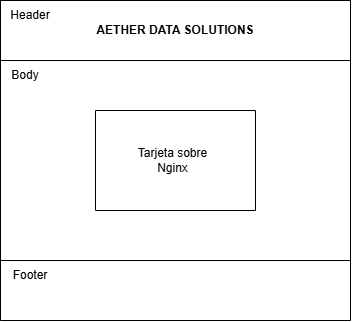
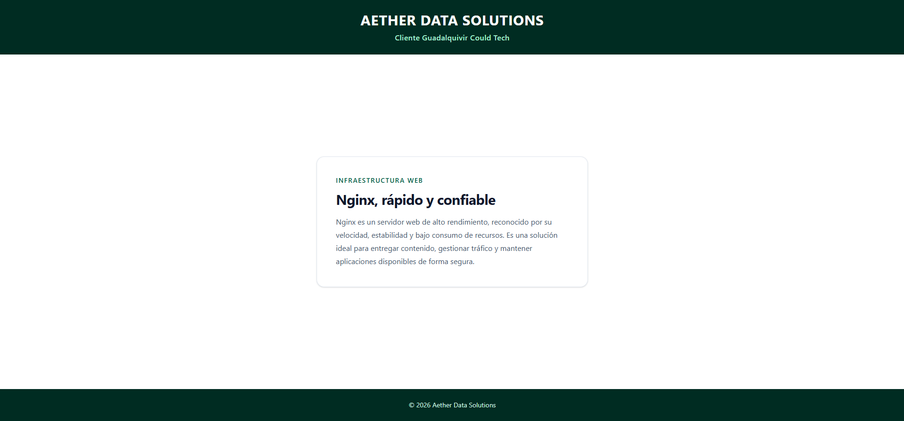

# PoC de Infraestructura (AEF Nginx)

Para hacer un landage page simple, hay que empezar por el diseño con un wireframe y un mockup.
**Wireframe**: algo básico y sencillo con un encabezado, un cuerpo con uns tarjeta de información y un pie de página. Lo he realiado en draw.io.

**Mockup**: es el wireframe pero mas real. He añadido colores, tipografía y el texto. Lo he hecho con Figma ([enlace](https://www.figma.com/make/U2DURHMvlEa5nKtfg3Qrw1/Landing-page-dise%C3%B1o-sencillo?t=kByIQK6E4FqSIUOi-20&fullscreen=1)).

Finalmente, he realizado una'landing page' muy asequible con HTML5 semántico y CSS3 sencillo siguiendo el mockup, con un "Reseteo" profesional al inicio del archivo. 